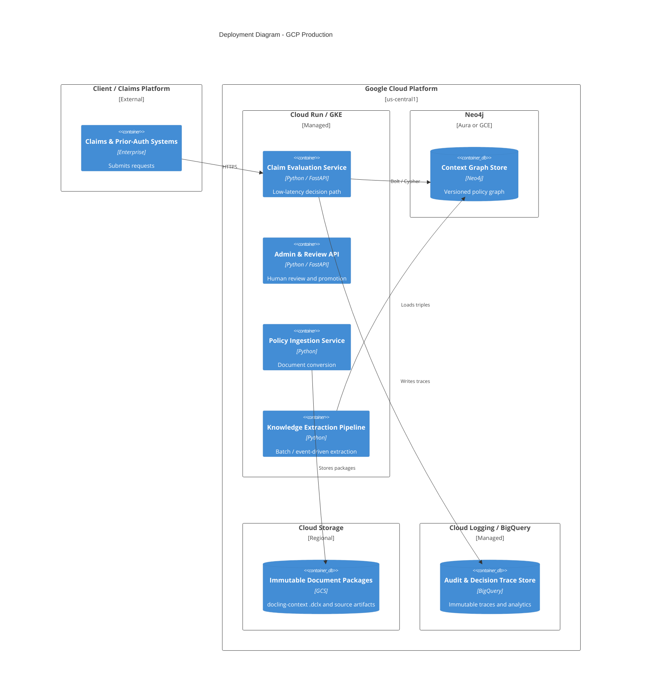

# C4 Deployment Diagram (GCP)

## Notes

- Evaluation path is sized for sub-second latency under expected claim volume
- Extraction path is batch-oriented and can scale independently
- All Decision Traces and graph versions are retained for audit
- Secrets and coding-system licenses managed via Secret Manager / appropriate controls
